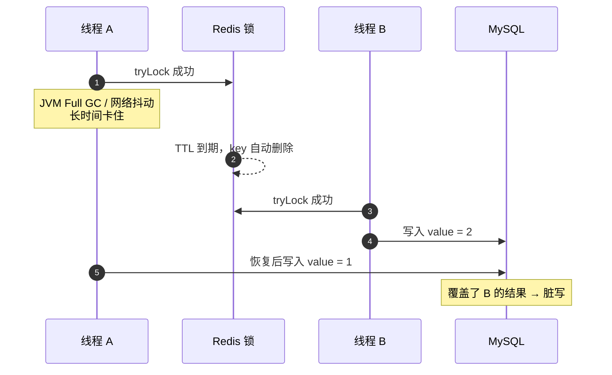
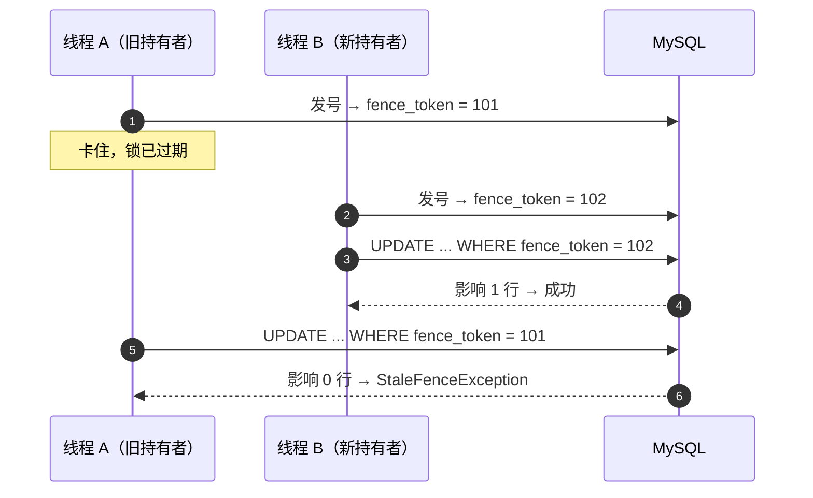
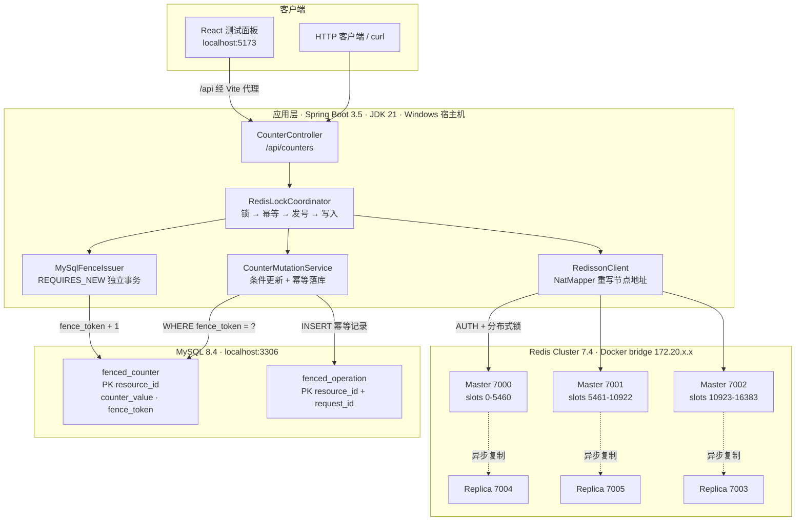
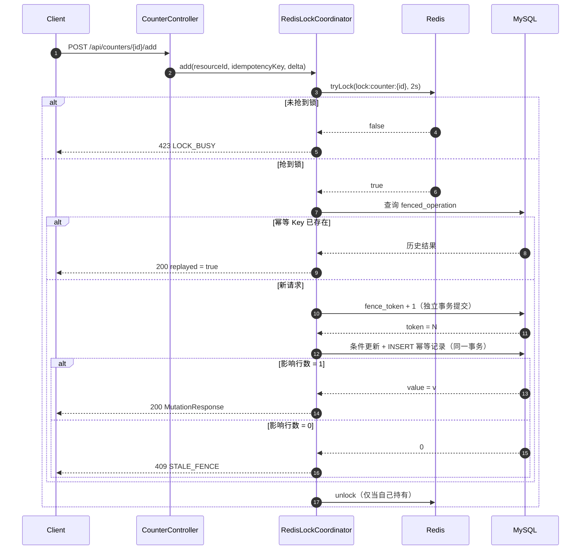

# CODE_INTRO — 项目说明

## 一句话

这是一个**分布式计数器的一致性演示项目**，用「Redis 分布式锁 + MySQL Fencing Token（栅栏令牌）」组合，解决一个经典难题：**锁已经失效、但旧持有者还没停下时的脏写**。

## 它到底在解决什么问题

只用 Redis 锁做互斥，会有这个致命的漏洞：



Redis 锁无法知道「A 是不是真的停住了」，因为它只判断 key 存不存在。**锁可以过期，但已经排队的写操作不会自动取消。**

## 核心解法：两把「锁」

| 层次 | 组件 | 作用 |
|---|---|---|
| 第一层 | Redis 分布式锁（Redisson） | 正常情况下的互斥，减少无效竞争 |
| 第二层 | MySQL Fencing Token | **权威裁决**：即使锁失效，旧持有者也写不进去 |

关键在于：令牌是**单调递增**的，且业务写入必须携带令牌做等值条件更新。



A 的写操作不是被「发现」后拦下的，而是**在数据库层面根本匹配不到行**。这是数据库行级原子性给出的保证，不依赖任何应用层判断。

## 技术架构



架构上的三条要点：

- **应用层只连 Master**：写请求必然走 Master，Replica 只做故障接管和数据冗余。
- **两套持久化职责分离**：Redis 只存锁（临时、可丢），MySQL 存令牌和业务数据（权威、不可回退）。
- **Docker 端口映射 + NatMapper**：节点 announce 的是 bridge 内网 IP，Redisson 通过 `setNatMapper` 统一改写为 `127.0.0.1` 才能从宿主机连上。

## 一次写请求的完整链路

`POST /api/counters/{resourceId}/add` 进入 [RedisLockCoordinator.add](file:///d:/release/temp/redis-fencing-single-host/src/main/java/com/example/fencing/service/RedisLockCoordinator.java#L32-L71)：

1. **抢 Redis 锁** — key 为 `lock:counter:{resourceId}`，花括号是 Redis Cluster 的 hash tag，保证同一资源的锁落在同一个 slot。
2. **判断是否重放** — 幂等 Key 已存在则直接返回历史结果，**不消耗新令牌**。
3. **MySQL 发号** — [MySqlFenceIssuer.issue](file:///d:/release/temp/redis-fencing-single-host/src/main/java/com/example/fencing/service/MySqlFenceIssuer.java#L20-L37) 在**独立事务（REQUIRES_NEW）**里执行 `UPDATE ... SET fence_token = fence_token + 1`，提交后才返回。之所以独立提交，是为了让令牌先于业务写入落盘——后面的写入才能用它做等值校验。
4. **条件写入** — [CounterMutationService.apply](file:///d:/release/temp/redis-fencing-single-host/src/main/java/com/example/fencing/service/CounterMutationService.java#L42-L63) 在另一个事务里执行 `UPDATE fenced_counter SET counter_value = counter_value + ? WHERE resource_id = ? AND fence_token = ?`。影响行数不等于 1 就抛 `StaleFenceException`。
5. **记录幂等事件** — 同一事务内插入 `fenced_operation`，作为「这个 Key 已处理过」的凭证。
6. **释放锁** — `finally` 中确认仍是自己持有才释放，绝不强删别人的锁。



## 三个关键设计

**1. 令牌由 MySQL 发号，而不是 Redis INCR**

Redis 的 INCR 虽然也单调，但 Redis 是缓存层，重启、切主、数据回滚都可能让计数回退。令牌一旦回退，旧请求就会重新「合法」，fence 就失效了。MySQL 的 `fenced_counter.fence_token` 是唯一权威源。

**2. 所有写入都带令牌等值条件**

建表脚本 [V1__init.sql](file:///d:/release/temp/redis-fencing-single-host/src/main/resources/db/migration/V1__init.sql) 顶部就写了：生产环境不允许 DELETE/TRUNCATE 或重置 `fence_token`。因为令牌单调性是整个方案的基石。

**3. 幂等表独立于业务表**

`fenced_operation` 以 `(resource_id, request_id)` 为主键，同一个幂等 Key 重复提交时返回第一次的结果并标记 `replayed=true`；如果 Key 相同但 `delta` 不同，则返回 409 `IDEMPOTENCY_CONFLICT`，而不是静默覆盖。

> 注意 [RedisLockCoordinator.assertStillOwnLock](file:///d:/release/temp/redis-fencing-single-host/src/main/java/com/example/fencing/service/RedisLockCoordinator.java#L73-L79) 的注释：Redis 侧的持锁检查只是**尽力而为**，跨系统的「我真的还持有锁吗」在原理上无法原子证明。真正兜底的是数据库的条件更新。

## 代码地图

```
src/main/java/com/example/fencing/
├── FencingApplication.java          启动类
├── config/RedisConfiguration.java   Redisson 客户端（cluster / single 双模式 + NatMapper）
├── web/CounterController.java       REST 入口，参数校验
├── service/
│   ├── RedisLockCoordinator.java    锁 → 幂等 → 发号 → 写入 的编排
│   ├── MySqlFenceIssuer.java        单调令牌发号（独立事务提交）
│   └── CounterMutationService.java  条件更新 + 幂等事件落库（单事务）
├── repository/
│   ├── CounterRepository.java       查计数器快照
│   └── OperationRepository.java     查/写幂等记录
├── model/                           AddRequest / MutationResponse / CounterSnapshot / OperationRecord
└── error/                           5 种业务异常 + ApiErrors 统一映射为 ProblemDetail
```

`RedisConfiguration` 里有一个针对 Windows Docker Desktop 的关键处理：Redis 节点在 bridge 网络里 announce 的是 `172.20.x.x` 内网 IP，Windows 宿主机连不通，所以通过 `setNatMapper` 把拿到的所有节点地址统一重写为 `127.0.0.1`，走 Docker 端口映射连接。

## HTTP 接口

| 方法 | 路径 | 说明 |
|---|---|---|
| `GET` | `/api/counters/{resourceId}` | 读取快照；不存在返回 404 |
| `POST` | `/api/counters/{resourceId}/add` | 原子加 delta；需 `Idempotency-Key` 头 |

请求体：`{"delta": 1}`（正整数）
响应体：

```json
{
  "resourceId": "demo",
  "idempotencyKey": "req-001",
  "delta": 1,
  "value": 3,
  "fenceToken": 2,
  "replayed": false
}
```

错误码（统一 RFC 7807 ProblemDetail，字段含 `errorCode`）：

| HTTP | errorCode | 触发条件 |
|---|---|---|
| 400 | `BAD_REQUEST` | 参数格式非法 / delta < 1 |
| 409 | `STALE_FENCE` | 携带的令牌已被更新的令牌取代 |
| 409 | `LOCK_LOST` | 执行中发现自己不再持锁 |
| 409 | `IDEMPOTENCY_CONFLICT` | 同 Key 但 delta 不一致 |
| 423 | `LOCK_BUSY` | 等待超时仍未抢到锁 |
| 503 | `LOCK_INTERRUPTED` | 等锁线程被中断 |

## 技术栈

Java 21 / Spring Boot 3.5.16 / Spring JDBC（不是 JPA）/ Flyway / Redisson 4.8.0 / MySQL 8.4 / Redis 7.4（3 Master + 3 Replica）/
React 18 + TypeScript + Vite 6 + Tailwind（`frontend/` 下的可视化测试面板）。

配置统一放在项目根目录 `.env`，Spring Boot 通过 `spring.config.import` 直接读它，Docker Compose 也从同一个文件取变量。

## 跑起来

```bash
# 1. 基础设施（项目根目录）
docker compose up -d

# 2. 后端（项目根目录）
mvn spring-boot:run

# 3. 前端
cd frontend && npm install && npm run dev
```

详细步骤和故障排查见 [docs/DEPLOY_SINGLE_HOST.md](docs/DEPLOY_SINGLE_HOST.md)。

## 测试验证了什么

[FencingIntegrationTest](file:///d:/release/temp/redis-fencing-single-host/src/test/java/com/example/fencing/FencingIntegrationTest.java) 用 Testcontainers 拉起真实的 MySQL 8.4 + Redis 7.4，覆盖三个场景：

1. **旧令牌必须写不进去** — 先后发两个令牌，用旧的写会被 `StaleFenceException` 拒绝，数据保持干净。
2. **并发不丢更新** — 6 个线程同时 `+1`，最终值恰好是 6，令牌也恰好是 6。
3. **幂等 Key 防重** — 同 Key 同 delta 返回 `replayed=true` 且值不变；同 Key 不同 delta 抛 `IDEMPOTENCY_CONFLICT`。

## 边界与限制

- 这是**教学/演示级实现**，重点是算法正确性，没有做生产级的可观测性、限流、压测。
- Redis 集群 3M + 3R 全部跑在同一台宿主机上，宿主机故障整体不可用。
- 令牌回退是不可恢复的灾难（例如恢复旧备份），所以生产上禁止重置 `fence_token`。
- Redis 锁只负责「让正常流量排队」，不负责正确性；去掉 Redis 锁方案依然正确（只是并发冲突会变多）。
