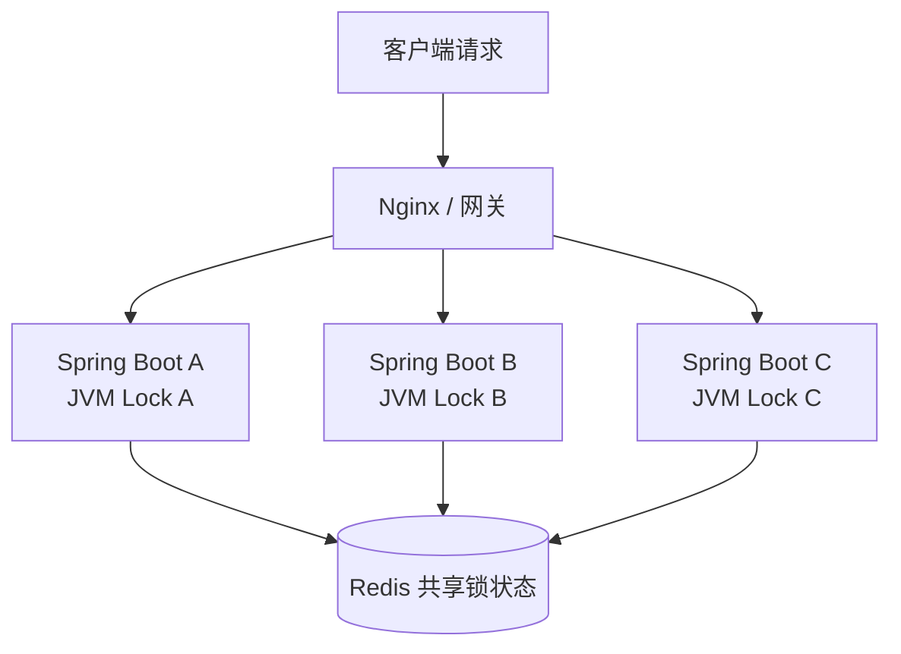
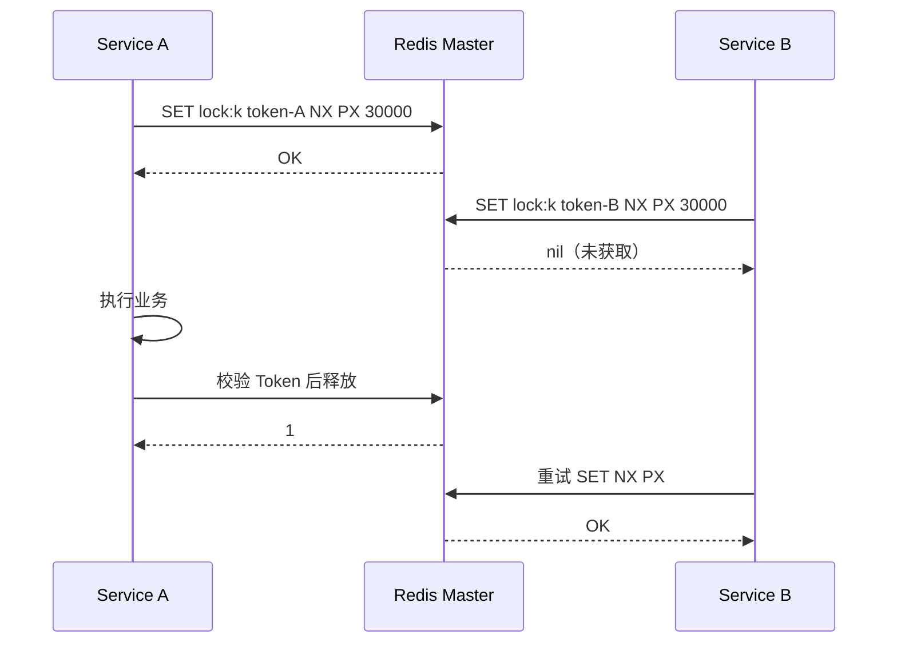
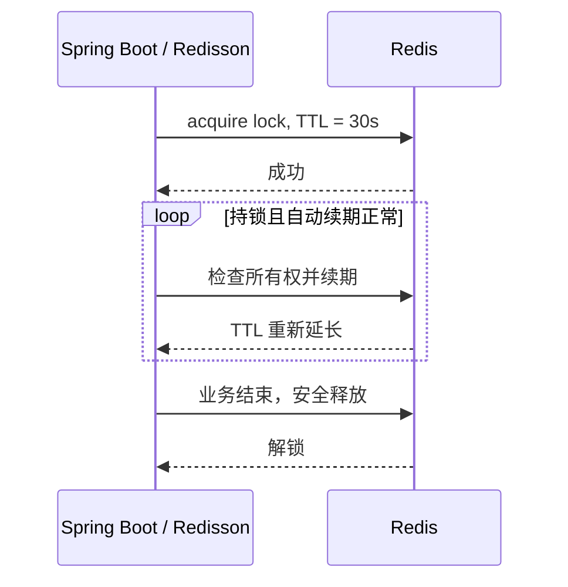
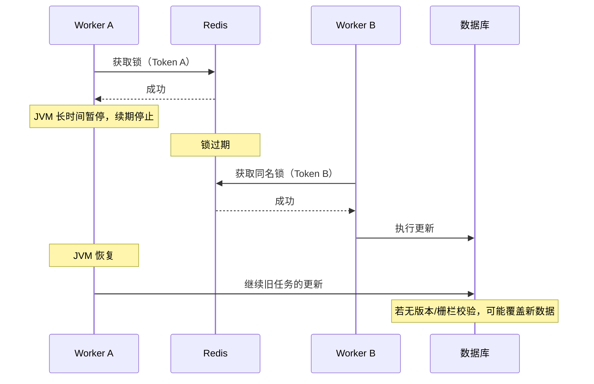
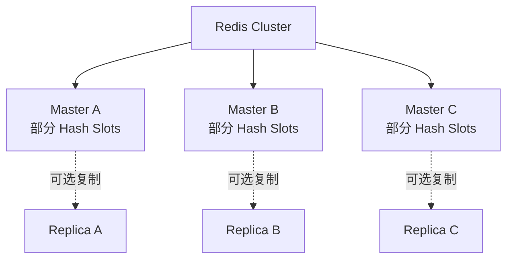

> **定位**：技术学习笔记 — Redis 架构、分布式锁、Lua 原子性、Watchdog、Hash Slot、Fencing Token 原理，以及三服务器部署示例。  
> **当前部署**：实际部署请以根目录 `README.md` 和 `docs/DEPLOY_SINGLE_HOST.md` 为准（Windows Docker Desktop bridge 网络 + Redisson NatMapper 是当前方案的关键实现细节）。

# Redis Cluster、分布式锁、Lua、Watchdog 与 Hash Slot 技术笔记

> **主题**：Redis 的架构定位、分布式锁实现、Lua 原子性、Watchdog 自动续期、主从故障切换、Fencing Token、Redis Cluster 多 Master 与 Hash Slot，以及三台 Linux 服务器的 Docker Compose 部署。  
> **适用技术栈**：Java 21 / Spring Boot 3 / Redisson / Redis Cluster / MySQL 8 / Docker Compose  
> **整理日期**：2026-11-01  
> **阅读对象**：中高级 Java 后端工程师、架构师、运维工程师

---

## 目录

1. [核心结论](#一核心结论)
2. [为什么需要 Redis，MySQL 能否替代](#二为什么需要-redismysql-能否替代)
3. [Redis 分布式锁的工作机制](#三redis-分布式锁的工作机制)
4. [Lua 脚本为什么重要](#四lua-脚本为什么重要)
5. [Watchdog 看门狗的实现原理与边界](#五watchdog-看门狗的实现原理与边界)
6. [多业务实例、多 Redis 节点与主从复制](#六多业务实例多-redis-节点与主从复制)
7. [Redis Cluster、Master、Replica、Sentinel 的区别](#七redis-clustermasterreplicasentinel-的区别)
8. [Hash Slot 原理、Hash Tag 与跨槽限制](#八hash-slot-原理hash-tag-与跨槽限制)
9. [Fencing Token 与业务强一致性](#九fencing-token-与业务强一致性)
10. [三台服务器部署 3 Master Redis Cluster](#十三台服务器部署-3-master-redis-cluster)
11. [初始化、验证与故障排查](#十一初始化验证与故障排查)
12. [3 Master + 3 Replica 生产拓扑](#十二3-master--3-replica-生产拓扑)
13. [Spring Boot + Redisson 正确接入](#十三spring-boot--redisson-正确接入)
14. [Redis 锁与 Spring 事务的执行顺序](#十四redis-锁与-spring-事务的执行顺序)
15. [生产检查清单、常见误区与场景选型](#十五生产检查清单常见误区与场景选型)
16. [参考资料](#十六参考资料)

---

## 一、核心结论

| 概念 | 解决的问题 | 不能保证什么 |
|---|---|---|
| **Redis** | 高性能共享状态、缓存、限流与分布式协调 | 不自动保证跨系统事务一致性 |
| **Redis 分布式锁** | 多个进程竞争同一资源时的互斥协调 | 不自动保证旧持有者永不执行 |
| **`SET key token NX PX ttl`** | 原子申请带过期时间的锁 | 不负责解锁时的所有权验证 |
| **Lua 脚本** | Redis 内组合命令的原子执行 | 不等于跨节点事务，也不保证脚本失败自动回滚 |
| **Watchdog** | 业务时间不可预测时，持锁期间自动续期 | 遇到 GC、网络隔离等状况不保证续期必然成功 |
| **Redis Master** | Redis 主节点，管理数据和写入 | 单个 Master 不等于整个 Cluster |
| **Redis Replica** | 复制 Master 的数据，供故障接管等用途 | 异步复制不等于无损强一致复制 |
| **Redis Cluster** | 多 Master 分片、节点发现、槽迁移与一定程度高可用 | 不天然保证锁在故障切换中绝不丢失 |
| **Hash Slot** | 将 Key 映射到逻辑分片，再由 Master 承担 | 不表示一把锁、一个事务或一个副本 |
| **Hash Tag** | 将相关 Key 强制落在同一 Slot | 滥用会导致热点槽 |
| **Fencing Token** | 让受保护资源识别并拒绝过期持有者 | 需要可靠令牌来源与下游校验机制 |

**重要认知：Redis Cluster、多个 Master、16384 个 Hash Slot 是同一架构的不同组成部分，不是互斥的部署选项。**

---

## 二、为什么需要 Redis？MySQL 能否替代？

### 2.1 单个 JVM 的锁只能保护本进程

Java 内置 `synchronized`、`ReentrantLock` 通常只对同一 JVM 中共享同一个锁对象的线程有效。

```java
synchronized (localMonitor) {
    // 这里仅保护同一个 JVM 中使用 localMonitor 的代码
}
```

多台 Spring Boot 服务器各自有一份内存锁，不能凭本地锁阻止其他服务器执行同一业务。



Redis 提供了所有实例都能访问的协调状态，可以用一个共享 Key 代表同一业务资源的锁。

### 2.2 MySQL 不仅能实现并发控制，有些场景更合适

例如库存扣减：

```sql
UPDATE product_stock
SET stock = stock - 1
WHERE product_id = 1001
  AND stock > 0;
```

检查影响行数即可判断本次扣减是否成功。该 SQL 在 InnoDB 中是受事务和行级并发控制保护的原子条件更新；为了避免超卖，通常**不需要额外增加 Redis 分布式锁**。

类似地：

- 订单防重复创建：数据库唯一索引 + 幂等键。
- 乐观并发更新：`UPDATE ... SET version=version+1 WHERE version=?`。
- 复杂数据一致性：数据库事务及约束。
- 高并发缓存重建与部分协调任务：Redis 锁可以降低重复工作。

**原则：先用数据库保证业务正确性，再根据性能和协调需求引入 Redis。**

### 2.3 Redis 还有哪些典型价值？

缓存（Cache Aside）、计数与限流、会话状态、临时去重、分布式协调、排行榜等。Redis 的优势通常是低延迟和丰富的数据结构，不是取代关系型数据库的 ACID 事务。

---

## 三、Redis 分布式锁的工作机制

### 3.1 最小加锁协议：SET NX PX

```redis
SET lock:order:1001 request-uuid-A NX PX 30000
```

参数：

- `lock:order:1001`：同一业务资源对应同一个锁 Key；
- `request-uuid-A`：高随机性、唯一的持有者 Token；
- `NX`：只有不存在才写入；
- `PX 30000`：自动过期时间 30 秒。

`NX` 与 TTL 在同一条 `SET` 中，避免分别执行 `SETNX` 和 `EXPIRE` 导致“加锁成功但 TTL 尚未设置”风险。



### 3.2 为什么必须要 TTL？

没有过期时间时，持锁进程崩溃可能留下永久死锁。TTL 为故障恢复提供了租约边界，但同时带来**业务未完成，锁先过期**的问题。

### 3.3 为什么不能直接 DEL？

```text
T0  A 获取锁
T1  A 执行太久，锁过期
T2  B 获取了同名锁
T3  A 业务结束，直接 DEL
T4  A 错误地删除了 B 的锁
```

因此解锁必须验证 Token。普通 `GET` 后 `DEL` 仍有并发窗口，需要原子脚本。

---

## 四、Lua 脚本为什么重要？

> 正确术语是 **Lua**（不是 Luna）。Redis 支持在服务端执行 Lua 脚本。

### 4.1 不安全的两条命令

```java
String owner = redisTemplate.opsForValue().get(key);
if (token.equals(owner)) {
    redisTemplate.delete(key);
}
```

`GET` 与 `DEL` 之间，锁可能过期并被其他客户端重新获得。即使判断正确，后续删除也可能删错。

### 4.2 Lua 原子解锁

```lua
-- KEYS[1] = 锁 Key
-- ARGV[1] = 本次请求持有者 Token
if redis.call('GET', KEYS[1]) == ARGV[1] then
    return redis.call('DEL', KEYS[1])
end
return 0
```

调用形式：

```redis
EVAL "if redis.call('GET', KEYS[1]) == ARGV[1] then return redis.call('DEL', KEYS[1]) end return 0" 1 lock:order:1001 request-uuid-A
```

Redis 的 Lua 执行期间不会插入其他客户端的命令，从而消除检查和删除之间的竞态窗口。

### 4.3 Lua 的原子性边界

1. **保证命令执行不被其他 Redis 命令穿插，并非像 MySQL 一样自动回滚。** 脚本前半段写入成功，后半段报错时，已执行的修改不应假设能自动撤销。
2. **不能横跨 Redis Cluster 不同 Master 创建原子事务。** 在 Cluster 中脚本涉及的全部 Key 必须遵循同槽约束，并显式通过 `KEYS` 传入。
3. **耗时脚本会阻塞实例。** 避免大循环、批量扫描与长时间计算。
4. Lua 只对 Redis 操作原子，不使 **Redis 与 MySQL 的更新**变成一个事务。

### 4.4 Lua 原子续期（原理示例）

```lua
if redis.call('GET', KEYS[1]) == ARGV[1] then
    return redis.call('PEXPIRE', KEYS[1], ARGV[2])
end
return 0
```

这是简单字符串锁的示例。**Redisson RLock 的底层结构不是这个简单 GET 模型**，它支持持有者识别、重入计数和等待通知，使用更复杂的内部逻辑。

---

## 五、Watchdog 看门狗的实现原理与边界

### 5.1 固定 TTL 的矛盾

业务可能运行 5 秒，也可能因为网络调用、数据库等待或 GC 暂停耗时 60 秒。若固定锁 TTL 是 30 秒，业务尚未完成时，其他节点就可能重新获得锁。

### 5.2 Watchdog 自动续期

Redisson 的 Watchdog 在持锁客户端正常工作时定期延长锁 TTL；默认 `lockWatchdogTimeout` 是 30 秒（可配置）。续期间隔在很多 Redisson 实现中按超时的约三分之一安排，具体以所用版本为准。



- 进程正常运行：可持续续期。
- 进程崩溃：不再续期，锁最终过期。
- 长时间 GC、事件循环拥堵、网络隔离、Redis 故障：可能导致续期失败。

### 5.3 Redisson 的两种调用有关键差别

```java
// 未显式指定 leaseTime：使用 Watchdog 机制
lock.lock();

// 明确指定租约 10 秒：到期自动释放；默认不使用 Watchdog 续期
lock.lock(10, TimeUnit.SECONDS);

// 最多等待 2 秒获取锁，不指定固定租约：使用 Watchdog
boolean acquired = lock.tryLock(2, TimeUnit.SECONDS);
```

**重要：Watchdog 是租约可用性机制，不能证明业务执行全过程始终拥有独占权限。**

### 5.4 Stale Lock Holder：过期持有者



所以高一致性场景还需要 Fencing Token 或其他数据库条件约束。

---

## 六、多业务实例、多 Redis 节点与主从复制

### 6.1 三种“多节点”不要混淆

| 场景 | 指的是什么 | 是否等价于 Cluster |
|---|---|---|
| 三台 Spring Boot 竞争同一个锁 | 多个业务实例 | 否，单 Redis 实例也可协调 |
| Redis Master + Replica | 主从复制/高可用拓扑 | 否，可独立于 Redis Cluster 使用 |
| Redis Cluster 三个 Master | 多数据分片 | 是，Cluster 的典型结构 |

### 6.2 Redis 主从复制为什么不能保证锁绝不丢失？

Redis 主从复制通常是异步的。可能发生：

1. A 在旧 Master 获取锁；
2. 旧 Master 返回成功，但尚未复制；
3. Master 宕机；
4. Replica 晋升，新 Master 没有原锁；
5. B 在新 Master 成功获取相同锁。

这意味着在故障切换边界，两个业务进程可能均认为自己有权执行。复制确认、客户端同步检查等机制可以缩小窗口，但不能简单把普通 Redis Cluster 视为强一致共识存储。

### 6.3 Redlock 与 Redis Cluster 不是一回事

- **Redis Cluster**：把不同 Key 归属到不同分片 Master；同一个 Key 在稳定状态下由一个 Master 负责。
- **Redlock**：针对多个相互独立 Redis 实例的锁算法，尝试获取多数独立实例的锁，并受到时间边界等条件约束。
- **Redisson RLock**：常用的可重入 Redis 锁实现；不要把 RLock、Redis Cluster 和 Redlock 三者混为一谈。

Redlock 的正确性存在假设与争议；要求严格协调顺序时，应考虑带事务比较更新的数据库，或适当的共识系统。

---

## 七、Redis Cluster、Master、Replica、Sentinel 的区别

### 7.1 基本关系



Redis Cluster 的特征：

- 多个 Master 分别承担 **16384 个逻辑槽的不同子集**；
- 对 Key 进行槽路由，客户端可缓存路由信息；
- `MOVED` / `ASK` 支持重定向和迁移；
- Replica 可在满足条件时接管故障 Master；
- Redis Cluster 只支持逻辑数据库 `0`，不支持使用 `SELECT` 切换多个 DB。

### 7.2 常用拓扑对比

| 拓扑 | 是否分片 | 是否支持自动故障接管 | 典型场景 |
|---|---:|---:|---|
| 单个 Redis | 否 | 否 | 开发测试、非关键缓存 |
| Master + Replica（无 Sentinel） | 否 | 需外部协调 | 只做复制，不含自动管理 |
| Master + Replica + Sentinel | 否 | 是（满足仲裁条件） | 单主数据集的高可用 |
| Cluster：3 Master + 0 Replica | 是 | **没有 Replica 可接管** | 分片实验、可接受故障的环境 |
| Cluster：3 Master + 3 Replica | 是 | 是（满足多数派等条件） | 常见生产分片高可用 |

**不是 Redis Cluster 和 Redis Master 二选一**。Redis Cluster 本身就包含 Master。Sentinel 和 Cluster 是不同的部署与故障管理模型，通常不需要叠加使用。

---

## 八、Hash Slot 原理、Hash Tag 与跨槽限制

### 8.1 为什么有 16384 个槽？

Redis Cluster 固定将 Key 空间分成 **16384 个逻辑 Hash Slot**，槽号为 `0 ... 16383`：

```text
HASH_SLOT(key) = CRC16-XMODEM(key) mod 16384
```

示意分布（具体槽边界由集群创建与迁移结果决定）：

```text
                       Redis Cluster
                 16384 Logical Hash Slots
                              │
                ┌─────────────┼─────────────┐
                │             │             │
            Master A      Master B      Master C
             0-5460       5461-10922    10923-16383
```

其设计价值是**将逻辑数据位置与物理服务器数量解耦**：扩容时移动部分 Slot，而不需要将每个 Key 改为对新 Master 数量取模。槽不是独立数据库，也不是副本或锁对象。

### 8.2 Hash Tag：人为让多个 Key 位于同一槽

```text
order:{1001}:status
order:{1001}:count
lock:order:{1001}
```

三个 Key 使用同一个 `{1001}` 标签，因此按 `1001` 计算哈希槽，落在同一 Slot。请注意：**同槽不代表相同 Key，也不代表自动共享一把锁。**

### 8.3 为什么需要同槽？

Redis Cluster 的多 Key 命令、事务和 Lua 脚本通常要求涉及的 Key 位于同一 Slot，否则会出现：

```text
CROSSSLOT Keys in request don't hash to the same slot
```

可以使用 `CLUSTER KEYSLOT` 进行验证：

```bash
redis-cli -c CLUSTER KEYSLOT 'order:{1001}:status'
redis-cli -c CLUSTER KEYSLOT 'order:{1001}:count'
```

### 8.4 Hash Tag 常见设计错误

```text
# 错误示范：所有业务 Key 共享同一 Hash Tag
lock:{global}:order:1001
lock:{global}:order:1002
lock:{global}:order:1003
```

这会让大量 Key 聚集到一个 Slot，容易形成热点分片。

**实践原则：只有必须一起执行原子多 Key 操作的 Key 才需要同槽；单 Key 锁完全可以自然分散到多个槽。**

### 8.5 Slot、Master、Replica 如何协作？

- Key 先映射 Slot。
- Slot 在稳定时由某个 Master 负责。
- Master 可有 Replica 复制其数据。
- 扩容/缩容时迁移 Slot；客户端处理 `MOVED` 和 `ASK`。
- Master 故障时，有合格 Replica 才可能完成接管。

---

## 九、Fencing Token 与业务强一致性

### 9.1 为什么 Watchdog 还不够？

旧锁持有者暂停后恢复，可能已经失去锁，却继续执行此前的业务逻辑。仅校验 Redis 当前是否持锁，无法撤销其此前向外部系统发送的操作。

### 9.2 栅栏令牌工作过程

```text
A 获得锁 → token = 101
A 暂停，租约失效
B 获得锁 → token = 102
B 写入受保护资源，资源记录 max_token = 102
A 恢复后尝试 token = 101 写入 → 资源拒绝
```

受保护的数据库必须比较令牌，才能阻止旧持有者。

简化 SQL：

```sql
UPDATE task_resource
SET status = 'RUNNING',
    last_fence = :incoming_token
WHERE id = :resource_id
  AND last_fence < :incoming_token;
```

实际还要根据业务要求增加状态转换条件、幂等键、版本号和事务约束。`incoming_token` 必须来自**可靠的严格单调递增机制**，不能默认普通 Redis `INCR` 在异步主从故障切换后永不回退。

### 9.3 数据库租约 + Fencing 常用于 Worker 任务所有权

任务表可包含：

```text
task_id
owner_worker_id
lease_until
fence_version
status
checkpoint_version
updated_at
```

由数据库事务原子地续期或接管：旧 Worker 若版本不匹配，就无法提交新的检查点。对长期任务、故障接管、跨 JVM 租约系统，这往往比单靠 Redis 锁更稳妥。

---

## 十、三台服务器部署 3 Master Redis Cluster

> **方案定位**：3 台 Linux 主机，3 个 Redis 容器，3 个 Master，**0 Replica**。可以实现分片；**不具备 Master 故障后的自动副本接管能力**。  
> **网络条件**：以下 `10.0.0.x` 为示例私网地址，实际部署请替换成三台互通的 IP。建议运行于可信内网/VPN，不要把无 TLS 的 Redis 暴露到公共互联网。

### 10.1 IP 规划

| 服务器 | 示例 IP | Redis 客户端端口 | Cluster Bus 端口 | 角色 |
|---|---|---:|---:|---|
| Server A | `10.0.0.11` | 6379/TCP | 16379/TCP | Master A |
| Server B | `10.0.0.12` | 6379/TCP | 16379/TCP | Master B |
| Server C | `10.0.0.13` | 6379/TCP | 16379/TCP | Master C |

**注意**：Bus 端口默认等于数据端口 `+10000`。此外，各 Redis 节点之间的数据迁移等操作也需要访问客户端端口 `6379`。

### 10.2 目录结构

```text
redis-cluster/
├── docker-compose.yml
└── .env
```

三台机器使用相同的 `docker-compose.yml`，使用各自的 `.env` 区分宣布地址。

### 10.3 docker-compose.yml

```yaml
# 3 台不同 Linux 主机各运行一个相同的 Compose 文件
# 集群最终为：3 Master + 0 Replica
services:
  redis:
    image: redis:7.4
    container_name: redis-cluster
    restart: unless-stopped
    network_mode: host
    environment:
      REDIS_ANNOUNCE_IP: ${REDIS_ANNOUNCE_IP:?Set REDIS_ANNOUNCE_IP in .env}
      REDIS_PASSWORD: ${REDIS_PASSWORD:?Set REDIS_PASSWORD in .env}
    volumes:
      - redis_cluster_data:/data
    command:
      - /bin/sh
      - -ec
      - |
        exec redis-server \
          --bind 0.0.0.0 \
          --port 6379 \
          --protected-mode yes \
          --requirepass "$$REDIS_PASSWORD" \
          --masterauth "$$REDIS_PASSWORD" \
          --cluster-enabled yes \
          --cluster-config-file /data/nodes.conf \
          --cluster-node-timeout 5000 \
          --cluster-announce-ip "$$REDIS_ANNOUNCE_IP" \
          --cluster-announce-port 6379 \
          --cluster-announce-bus-port 16379 \
          --cluster-require-full-coverage yes \
          --appendonly yes

volumes:
  redis_cluster_data:
```

关键配置：

| 配置 | 含义 |
|---|---|
| `network_mode: host` | Linux 主机网络直连，避免端口 NAT/映射影响集群发现与路由 |
| `REDIS_ANNOUNCE_IP` | 节点向其他节点和客户端公布的可达地址 |
| `cluster-enabled yes` | 开启 Cluster 模式 |
| `cluster-config-file /data/nodes.conf` | 集群自动管理的节点元数据，不能当静态模板随意覆盖 |
| `cluster-announce-port` | 客户端可达端口 |
| `cluster-announce-bus-port` | 节点间 Cluster Bus 端口 |
| `cluster-require-full-coverage yes` | 默认要求所有槽正常才能使集群处于健康服务状态 |
| `appendonly yes` | 启用 AOF 持久化，**并不等于零数据丢失** |

**关于 Docker Compose 中的 `$$`**：用于阻止 Compose 提前展开变量，交给容器内 shell 解析。

### 10.4 每台主机的 .env

Server A：

```dotenv
REDIS_ANNOUNCE_IP=10.0.0.11
REDIS_PASSWORD=replace-with-a-long-random-secret
```

Server B：

```dotenv
REDIS_ANNOUNCE_IP=10.0.0.12
REDIS_PASSWORD=replace-with-a-long-random-secret
```

Server C：

```dotenv
REDIS_ANNOUNCE_IP=10.0.0.13
REDIS_PASSWORD=replace-with-a-long-random-secret
```

**以上密码是占位符，不可直接用于生产。** 在可信终端中生成高强度密码：

```bash
openssl rand -hex 32
```

将生成的密码配置到三台主机，保持**同一密码**，并限制 `.env` 读取权限：

```bash
chmod 600 .env
```

此 Compose 示例为易于理解而使用环境变量和 Redis `requirepass`。对正式生产环境，建议改成专门管理的 Redis ACL 配置和 Secret 管理方案，避免密码出现在 Docker 进程参数、配置展示或备份中。

### 10.5 网络与安全检查

三台 Redis 主机之间，应互相允许：

- `6379/TCP`：节点互通及授权应用访问；
- `16379/TCP`：仅集群节点互通。

客户端（Spring Boot、Redisson）必须能够访问**三个 Master 宣布出来的地址和客户端端口**；只允许客户端访问一个启动节点而阻断其他 Master，会导致路由或重定向失败。

**防火墙须按实际内网 IP 白名单放行**；不要直接面向任意公网来源开放 6379/16379。多机跨公网通信时优先使用私有网络/VPN 和合适的加密方案。

### 10.6 三台服务器启动

分别在 Server A / B / C：

```bash
docker compose config --quiet
docker compose up -d
docker compose ps
docker logs --tail=100 redis-cluster
```

**不要在每台服务器都单独执行创建集群命令。** 应在三个 Redis 容器均正常启动后，只从其中一台执行一次 `--cluster create`。

---

## 十一、初始化、验证与故障排查

### 11.1 创建集群（仅执行一次）

在任意一台机器上：

```bash
docker exec -it redis-cluster sh -c '
  export REDISCLI_AUTH="$REDIS_PASSWORD"
  redis-cli --cluster create \
    10.0.0.11:6379 \
    10.0.0.12:6379 \
    10.0.0.13:6379 \
    --cluster-replicas 0
'
```

根据提示输入 `yes`。成功后应显示类似：

```text
[OK] All 16384 slots covered.
```

仅在**新建、尚无数据、尚未组群的节点**上使用上述命令。已有业务数据和 Cluster 元数据的实例，不能简单反复初始化。

### 11.2 查看集群状态

```bash
docker exec redis-cluster sh -c '
  REDISCLI_AUTH="$REDIS_PASSWORD" redis-cli cluster info
'
```

成功时重点检查：

```text
cluster_state:ok
cluster_slots_assigned:16384
cluster_slots_ok:16384
cluster_known_nodes:3
cluster_size:3
```

再看节点和槽：

```bash
docker exec redis-cluster sh -c '
  REDISCLI_AUTH="$REDIS_PASSWORD" redis-cli cluster nodes
'
```

### 11.3 验证键路由和 Hash Tag

```bash
docker exec redis-cluster sh -c '
  export REDISCLI_AUTH="$REDIS_PASSWORD"
  redis-cli -c SET "order:{1001}:status" CREATED
  redis-cli -c GET "order:{1001}:status"
  redis-cli CLUSTER KEYSLOT "order:{1001}:status"
  redis-cli CLUSTER KEYSLOT "order:{1001}:count"
'
```

两个同 Hash Tag 的 Key 应得到相同 Slot 号。`-c` 表示 `redis-cli` 按 Cluster 重定向操作。

### 11.4 最常见错误

| 现象 | 排查方向 | 处理措施 |
|---|---|---|
| `cluster_state:fail` | 有槽不可用、节点掉线、故障未恢复 | `cluster nodes`、`cluster info`、系统/容器日志 |
| `MOVED ...` | 客户端没有跟随路由 | 启用 Cluster-aware 客户端或 `redis-cli -c` |
| `CROSSSLOT` | 多 Key 分属不同 Slot | 合理使用 `{hash-tag}` |
| Redis 节点无法互通 | 6379/16379 防火墙、路由、地址不正确 | 双向检查 TCP 可达性 |
| 客户端只能访问启动节点 | 客户端无法访问公布的其他节点 | 检查 `cluster-announce-ip` 与客户端网络 |
| 重启节点后身份丢失 | `/data/nodes.conf` / 持久化目录未保留 | 保留 volume，不要随意删除节点数据 |
| 单 Master 宕机后全局不可用 | 3M+0R 没有可接管 Replica | 采用 3M+3R 或恢复故障节点 |
| 加锁后仍有重复业务 | TTL 过期、主从切换、旧任务恢复 | 数据库幂等、版本校验、Fencing |

### 11.5 不要随意清理数据目录

`/data/nodes.conf`、AOF 和其他持久化文件属于集群状态；在真实生产环境执行 `docker compose down -v` 可能删除持久化卷并造成不可恢复的数据损失。文档不提供面向生产数据的“强制删卷重置”操作。

---

## 十二、3 Master + 3 Replica 生产拓扑

如果只有三台物理服务器，仍可在**每台机器运行两个 Redis 实例**，组成六实例集群：

```text
Server A (10.0.0.11)    Server B (10.0.0.12)    Server C (10.0.0.13)
--------------------    --------------------    --------------------
Master A :6379          Master B :6379          Master C :6379
Replica C:6380          Replica A:6380          Replica B:6380
```

每个 Master 的 Replica 尽可能安排在**另一台物理服务器**上，避免同一主机故障同时带走该 Master 和其全部副本。示例中使用不同端口：

| 实例端口 | 默认 Cluster Bus 端口 |
|---|---|
| 6379 | 16379 |
| 6380 | 16380 |

六个实例启动后，新集群通常可用：

```bash
redis-cli --cluster create \
  10.0.0.11:6379 10.0.0.11:6380 \
  10.0.0.12:6379 10.0.0.12:6380 \
  10.0.0.13:6379 10.0.0.13:6380 \
  --cluster-replicas 1
```

`redis-cli` 会尝试进行角色分配，但**一定要通过 `CLUSTER NODES` 验证各 Replica 的 Master 关系、是否跨主机放置**。正式生产需要完整的六实例 Compose、不同的数据卷、资源配额、备份与故障切换演练，不能把 3M+0R 配置简单复制一份就视为完成高可用。

**即使采用 3M+3R，Redis 异步复制和故障切换仍不意味着所有已确认写入都具备强一致、零丢失保证。**

---

## 十三、Spring Boot + Redisson 正确接入

### 13.1 Cluster 模式连接

以下是 Spring 配置示例，所用 Redisson 依赖版本应与项目 Spring Boot / Java 版本兼容，并通过统一依赖管理锁定。

```java
import org.redisson.Redisson;
import org.redisson.api.RedissonClient;
import org.redisson.config.Config;
import org.springframework.context.annotation.Bean;
import org.springframework.context.annotation.Configuration;

@Configuration
public class RedissonClusterConfig {

    @Bean(destroyMethod = "shutdown")
    public RedissonClient redissonClient() {
        Config config = new Config();
        config.setLockWatchdogTimeout(30_000);
        config.useClusterServers()
            .addNodeAddress(
                "redis://10.0.0.11:6379",
                "redis://10.0.0.12:6379",
                "redis://10.0.0.13:6379"
            )
            .setPassword(System.getenv("REDIS_PASSWORD"));
        return Redisson.create(config);
    }
}
```

这些地址必须是应用节点实际可达的地址。对于生产系统，配置最好集中到环境变量、配置中心或 Secret 管理器，而不是把密码写进 Java 源码。

### 13.2 持锁执行订单逻辑

```java
import java.util.concurrent.TimeUnit;
import org.redisson.api.RLock;
import org.redisson.api.RedissonClient;
import org.springframework.stereotype.Service;
import lombok.RequiredArgsConstructor;

@Service
@RequiredArgsConstructor
public class OrderLockService {

    private final RedissonClient redissonClient;
    private final OrderTxService orderTxService;

    public void process(Long orderId) {
        String key = "lock:order:{" + orderId + "}";
        RLock lock = redissonClient.getLock(key);
        boolean acquired = false;

        try {
            acquired = lock.tryLock(2, TimeUnit.SECONDS);
            if (!acquired) {
                throw new IllegalStateException("订单正在处理中");
            }

            // 单独的 Bean：事务在方法返回前完成提交
            orderTxService.processInTransaction(orderId);
        } catch (InterruptedException ex) {
            Thread.currentThread().interrupt();
            throw new IllegalStateException("获取锁被中断", ex);
        } finally {
            if (acquired && lock.isHeldByCurrentThread()) {
                lock.unlock();
            }
        }
    }
}
```

事务服务：

```java
import org.springframework.stereotype.Service;
import org.springframework.transaction.annotation.Transactional;
import lombok.RequiredArgsConstructor;

@Service
@RequiredArgsConstructor
public class OrderTxService {

    private final OrderMapper orderMapper;

    @Transactional(rollbackFor = Exception.class)
    public void processInTransaction(Long orderId) {
        // 例如：仅允许状态为 PENDING 的订单更新
        int rows = orderMapper.updatePendingOrder(orderId);
        if (rows != 1) {
            throw new IllegalStateException("订单状态不允许重复处理");
        }
    }
}
```

数据库层采用条件更新更稳妥，例如：

```sql
UPDATE orders
SET status = 'PROCESSING'
WHERE id = #{orderId}
  AND status = 'PENDING';
```

### 13.3 持锁代码的重要边界

- `isHeldByCurrentThread()` 可以避免当前线程释放并非自己持有的 Redisson 锁，但不能替代数据库幂等或栅栏校验。
- `tryLock` 失败应采取明确策略：返回冲突、重试、排队或放弃，而不是无限忙等。
- Redisson 的普通 `RLock` 与自写的 `SET` 字符串锁内部结构不同，不能混用脚本操作同一个锁 Key。
- 对长期处理的异步任务，请考虑锁持有线程、跨线程释放以及 Worker 接管逻辑，不能机械地在不同线程上调用 `unlock()`。

---

## 十四、Redis 锁与 Spring 事务的执行顺序

### 14.1 容易犯的错误

```java
@Transactional
public void wrong() {
    lock.lock();
    try {
        // 数据库操作
    } finally {
        lock.unlock();
    }
} // Spring 代理可能在此之后才提交事务
```

假设事务由外层 Spring 代理开启，可能出现：

```text
Spring 开始 MySQL 事务
  -> Redis 获取锁
  -> 执行数据库写入
  -> Redis 释放锁
  -> Spring 提交事务
```

这样锁释放时数据库修改可能还没提交，下一位持锁者已能进入同一业务临界区。

### 14.2 更合理的顺序

```text
获取 Redis 锁
  -> 调用独立 Spring Bean 的 @Transactional 方法
  -> MySQL 提交事务
  -> 方法返回
  -> 释放 Redis 锁
```

其中一个原因是 Spring 默认代理模式下的**自调用不会经过事务代理**，因此事务方法应通过代理实际调用；也可以使用 `TransactionTemplate` 明确包裹事务代码。

**最后仍应依靠数据库唯一约束、条件更新或 Fencing Token 保护数据。** 锁覆盖了事务提交时间，也无法消除 Redis 锁因故障切换或租约到期而失效的风险。

---

## 十五、生产检查清单、常见误区与场景选型

### 15.1 生产检查清单

- [ ] 明确 Redis 是用于缓存、协调还是核心业务状态；不要把所有正确性依赖放在锁上。
- [ ] 统一锁 Key 命名与业务资源粒度，并确保唯一的 Owner Token。
- [ ] 单次加锁原子设置 TTL；解锁时校验所有权。
- [ ] 区分固定 `leaseTime` 与 Watchdog 自动续期。
- [ ] 业务流程使用数据库约束/条件更新实现幂等与状态一致性。
- [ ] Worker 接管场景考虑 Fencing Token 和数据库版本检查。
- [ ] 确保 Cluster-aware 客户端能够访问所有公布的 Master 地址。
- [ ] 同一脚本/事务的多 Key 正确设计 Hash Tag，避免跨槽。
- [ ] 注意热点 Slot，不要对所有 Key 使用 `{global}`。
- [ ] 有高可用目标时部署跨服务器 Replica，而不是只部署 3 Master。
- [ ] 只开放授权网段的客户端端口和 Cluster Bus 端口。
- [ ] 启用持久化、备份、告警和版本管理，但不要将 AOF 等同于强一致提交。
- [ ] 定期演练 Master 崩溃、网络分区、JVM 停顿与租约接管。

### 15.2 常见误区

| 误区 | 正确理解 |
|---|---|
| Redis Cluster 与多 Master 二选一 | Cluster 本身就是多 Master 分片机制 |
| 三台 IP 部署三个 Master 就自动高可用 | 无 Replica 时 Master 故障无法自动接管对应分片 |
| Hash Slot 是数据的副本 | Slot 是逻辑分片，不是副本 |
| 同一 Hash Slot 的 Key 共用一把锁 | Slot 仅负责路由，不改变 Key 的独立性 |
| Lua = 跨所有 Redis 节点的事务 | 原子性限定在脚本运行的 Redis 执行环境，同槽规则很重要 |
| 使用 Watchdog 就不会重复执行 | 续期失败、故障切换、旧持有者恢复仍有风险 |
| 设置了 TTL 就可以无条件 DEL | 必须比较 Owner，避免误删新持有者的锁 |
| Redlock = Redis Cluster | Redlock 是独立实例锁算法，Cluster 是数据分片架构 |
| Redis 锁可以取代数据库约束 | 核心数据仍需数据库自身维护一致性 |

### 15.3 场景选型建议

| 场景 | 推荐优先方案 |
|---|---|
| 库存避免超卖 | MySQL 原子条件更新 |
| 同一请求重复提交 | 幂等键 + 唯一索引 |
| 高频缓存重建 | Redis 分布式锁 + TTL |
| 微服务临界区协调 | Redisson RLock，合理控制等待和持锁时间 |
| 长时间任务、Worker 接管 | 数据库租约 + Fencing/版本号 + 检查点 |
| 单数据集高可用 | Sentinel 主从（不需分片时） |
| 大数据量或多分片吞吐 | Redis Cluster + 多 Master + Replica |
| 严格的跨节点协调与顺序 | 能提供相应一致性保证的事务数据库或共识协调存储 |

---

## 十六、参考资料

以下均为官方文档或项目维护者文档，查阅时应注意 Redis / Redisson 实际使用的版本。

1. [Redis 分布式锁模式](https://redis.io/docs/latest/develop/clients/patterns/distributed-locks/)
2. [Redis SET 命令（NX、PX、锁 Token）](https://redis.io/docs/latest/commands/set/)
3. [Redis Lua 脚本执行](https://redis.io/docs/latest/develop/programmability/eval-intro/)
4. [Redis EVAL 命令及 KEYS 规则](https://redis.io/docs/latest/commands/eval/)
5. [Redis Cluster 官方规范](https://redis.io/docs/latest/operate/oss_and_stack/reference/cluster-spec/)
6. [Redis Cluster 扩容与部署指南](https://redis.io/docs/latest/operate/oss_and_stack/management/scaling/)
7. [Redisson Locks and Synchronizers](https://redisson.pro/docs/data-and-services/locks-and-synchronizers/)

---

## 百字以内摘要

Redis Cluster 通过多个 Master 管理 16384 个 Hash Slot，实现数据分片与扩容。分布式锁使用原子加锁与 Lua 安全解锁，Watchdog 自动续期，但无法消除故障切换和过期持有者风险。关键业务仍需数据库幂等、条件更新及 Fencing Token 保障一致性。
