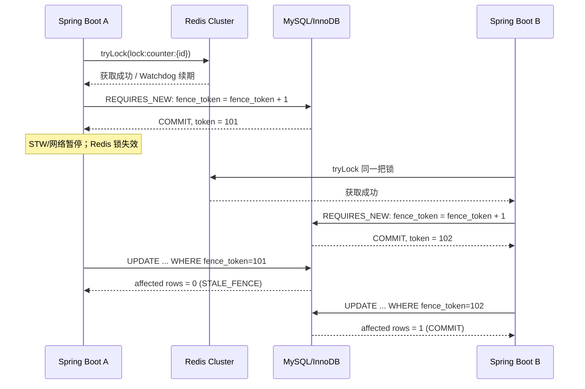

> **定位**：Fencing Token 完整实现原理与时序分析 — 为什么 Redis 锁不够，为什么 MySQL 必须同时负责 Token 发号和写入校验。  
> **当前代码**：实际代码在 `src/main/java/com/example/fencing/`；部署命令和环境变量配置见根目录 `README.md` 和 `docs/DEPLOY_SINGLE_HOST.md`。

# Redis Cluster 分布式锁 + MySQL Fencing Token（完整 Spring Boot 示例）

> Java 21 / Spring Boot 3.5.16 / Redisson 4.8.0 / MySQL 8.4 / Redis 7.4  
> **互斥由 Redis 负责，最终写入许可由 MySQL 的 fencing_token 决定。**  
> 这是可启动的参考工程，不是已经针对特定生产环境进行的高可用认证。

## 一、为什么不能只依赖 Redis 锁？

Redis Cluster 的 Master/Replica 复制不是强一致提交。即便使用 Lua 安全解锁以及 Watchdog 自动续期，也可能遇到 JVM STW 暂停、网络分区或 Redis 主从切换：旧客户端持锁已经失效，随后又恢复并继续执行。因此业务数据库必须能够拒绝旧客户端的写入。

本方案刻意**不使用 Redis INCR 生成 fencing token**，而让 MySQL 同时负责 **Token 顺序** 与 **资源写入判断**，避免 Redis 主从切换导致发号回退、进而影响正确性。

## 二、核心时序



MySQL 的 `UPDATE` 行锁使 Token 切换和业务更新发生数据库层面的串行化，不存在 A 用旧 Token 覆盖已经生效的新 Token 的情况。注意：当 A 的数据库写事务先拿到行锁时，B 的发号事务必须等待其提交；此时 A 的写入在线性顺序上发生在 B 新 Token 生效之前，并不构成旧 Token 违规写入。

## 三、目录

```text
redis-mysql-fencing-demo/
├── pom.xml
├── Dockerfile
├── docker-compose.yml                  # 单机演示：3 Redis Master + MySQL + API
├── .env.example
├── src/main/java/com/example/fencing/
│   ├── config/RedisConfiguration.java
│   ├── service/RedisLockCoordinator.java
│   ├── service/MySqlFenceIssuer.java
│   ├── service/CounterMutationService.java
│   ├── repository/CounterRepository.java
│   ├── repository/OperationRepository.java
│   ├── web/CounterController.java
│   └── error/...
├── src/main/resources/db/migration/V1__init.sql
├── src/test/java/com/example/fencing/FencingIntegrationTest.java
└── deploy/three-host/
    ├── redis-compose.yml               # 三台不同 IP：每台 1 Master
    └── .env.example
```

## 四、单机 Docker Compose 一键演示

所有 Redis 节点和 Spring Boot 容器使用**同一 Docker bridge 网络且不映射 Redis 端口**，Redis Cluster 向其他容器返回的是可达的容器 IP。Docker 官方提示 Cluster 不适合 NAT/端口重映射；该部署方式在容器间使用直接可达地址。三台不同宿主机则使用后面的 `host` 网络部署方案。

在项目根目录：

```bash
cp .env.example .env
openssl rand -hex 32    # 填到 .env 的 REDIS_PASSWORD
openssl rand -hex 32    # 填到 .env 的 MYSQL_ROOT_PASSWORD
openssl rand -hex 32    # 填到 .env 的 MYSQL_APP_PASSWORD
docker compose config --quiet
docker compose up -d --build
docker compose ps
docker compose logs --tail=120 redis-cluster-init api
```

**注意**：`.env.example` 的密码值故意留空。必须填入三项，且不要提交 `.env`。测试机可以通过 `docker compose down` 停止；`down -v` 会**永久删除 MySQL 与 Redis 数据**，导致 Token 记录丢失，严禁用于保留业务数据的环境。

### 集群检查

```bash
docker compose exec redis-1 sh -c 'REDISCLI_AUTH="$REDIS_PASSWORD" redis-cli cluster info'
docker compose exec redis-1 sh -c 'REDISCLI_AUTH="$REDIS_PASSWORD" redis-cli cluster nodes'
```

应看到 `cluster_state:ok` 和 `cluster_slots_assigned:16384`，三个 `master`。演示环境是 **3 Master + 0 Replica**，无法在 Master 故障后自动接管；它不是生产高可用方案。

## 五、HTTP 使用方法

服务默认只监听宿主机 `127.0.0.1:8080`。示例在 Linux/macOS Bash 中执行；PowerShell 可用 `curl.exe`，注意引号规则。

首次新增资源会自动创建 MySQL 行并生成 Token 1：

```bash
curl -sS -X POST http://127.0.0.1:8080/api/counters/order_1001/add \
  -H 'Content-Type: application/json' \
  -H 'Idempotency-Key: job_001' \
  -d '{"delta":5}'
# {"resourceId":"order_1001","idempotencyKey":"job_001",
#  "delta":5,"value":5,"fenceToken":1,"replayed":false}
```

再次使用相同 `Idempotency-Key`，返回 `replayed:true` 且余额不会重复增加：

```bash
curl -sS -X POST http://127.0.0.1:8080/api/counters/order_1001/add \
  -H 'Content-Type: application/json' \
  -H 'Idempotency-Key: job_001' \
  -d '{"delta":5}'
```

新的请求 ID 才会触发新的令牌与业务更新：

```bash
curl -sS -X POST http://127.0.0.1:8080/api/counters/order_1001/add \
  -H 'Content-Type: application/json' \
  -H 'Idempotency-Key: job_002' \
  -d '{"delta":3}'
# value=8, fenceToken=2
curl -sS http://127.0.0.1:8080/api/counters/order_1001
```

相同 Idempotency-Key 携带不同 delta 返回 `409 IDEMPOTENCY_CONFLICT`；获取锁超时返回 `423 LOCK_BUSY`。旧 Token 写入返回 `409 STALE_FENCE`（不向公众开放任意指定 Token 的接口）。

## 六、核心 SQL 安全边界

**独立事务生成并提交 Token：**

```sql
INSERT IGNORE INTO fenced_counter(resource_id, counter_value, fence_token)
VALUES ('order_1001', 0, 0);

UPDATE fenced_counter
   SET fence_token = fence_token + 1
 WHERE resource_id = 'order_1001'
   AND fence_token < 9223372036854775807;

SELECT fence_token FROM fenced_counter WHERE resource_id = 'order_1001';
-- 上述操作在同一个 REQUIRES_NEW 事务内提交后，才允许执行写业务。
```

**每条受保护写操作都要验证 Token：**

```sql
UPDATE fenced_counter
   SET counter_value = counter_value + :delta
 WHERE resource_id = :resource_id AND fence_token = :token;
-- 影响行数不是 1 => stale/reject; 不能继续执行其它业务写入。
```

该判断与幂等日志 INSERT 在**同一个业务事务**中提交；失败时事务回滚。

## 七、验证真正的过期客户端隔离

运行 Testcontainers 集成测试（需要 Docker 和 Maven）：

```bash
mvn test
```

`FencingIntegrationTest.staleWriterMustNotModifyAfterNewTokenCommitted()` 在真实 MySQL 容器上：

1. 先发放 `oldToken`；
2. 再发放更大的 `newToken`（模拟新持锁者获得所有权）；
3. 旧请求使用 `oldToken` 写入，必须抛 `StaleFenceException`，数据库 value 不变；
4. 新请求使用 `newToken` 写入，数据库 value 正确增加。

另一个测试验证相同 Idempotency-Key 不重复入账，并拒绝不同 delta 的重复 Key。

**本工程包含自动化测试代码，但源文件生成环境没有 Maven 和 Docker，未执行端到端构建/容器测试；需要你在本机或 CI 中运行上述命令确认。**

## 八、部署到三台不同 IP 的 Redis Master

服务器：`10.0.0.11 / 10.0.0.12 / 10.0.0.13`（使用你的真实内网地址）。每台分别执行：

```bash
cd deploy/three-host
cp .env.example .env
# 修改本机 REDIS_ANNOUNCE_IP；三台 REDIS_PASSWORD 必须完全相同
docker compose -f redis-compose.yml up -d
```

三台都启动后，在任意一台执行一次：

```bash
docker exec -it redis-master sh -c '
  export REDISCLI_AUTH="$REDIS_PASSWORD"
  redis-cli --cluster create \
    10.0.0.11:6379 10.0.0.12:6379 10.0.0.13:6379 \
    --cluster-replicas 0
'
```

输入 `yes` 确认。必须保证 TCP 6379 和 16379 **仅对授权客户端和三台 Redis 节点开放**。Redis 在此示例中没有 TLS；优先使用内网/专用 VPN，不要将其暴露公网。

在三个 Spring Boot 实例上配置相同的独立 MySQL 主库：

```bash
APP_REDIS_MODE=cluster
APP_REDIS_NODES=redis://10.0.0.11:6379,redis://10.0.0.12:6379,redis://10.0.0.13:6379
REDIS_PASSWORD=你的三台一致的密码
DB_URL=jdbc:mysql://MYSQL_PRIVATE_IP:3306/fencing_demo?useUnicode=true\&connectionTimeZone=UTC
DB_USER=fencing_app
DB_PASSWORD=你的数据库账号密码
```

生产需要对 MySQL 用户最小权限、Flyway 迁移授权、连接加密、数据库故障切换/持久性、监控告警以及备份恢复进行独立评审；三节点 Redis 的“分片”并不提供 HA。建议对业务关键的 Redis Cluster 配置 3 Master + 3 Replica（六实例，Replica 跨宿主机），但**数据正确性始终依赖 MySQL 的 Token 校验**。

## 九、设计边界（必须阅读）

- **受保护资源必须有 MySQL 的同一行或同一强一致协调行进行串行化**。当前示例在 `fenced_counter` 同一行既管理 Token 又执行业务更新，避免跨表检查的锁序问题；拆分表时必须在事务中以锁定读/条件更新保证同一顺序。
- **禁止绕过校验直接执行写入**。Fencing Token 只保护主动校验它的资源；其他服务、异步回调、外部 API 或数据库触发器也必须有相应校验/幂等机制。
- **`fence_token` 不得重置/回退**。不要对资源表 `DELETE` / `TRUNCATE`、在不同数据源独立发号、用历史备份恢复出更小 Token；恢复时需要相应的 epoch/全局版本策略。
- **MySQL 必须提供可靠的提交与主节点切换语义**。如果数据库故障切换丢失已提交的 Token，仍可能回退；MySQL 的集群/备份方案应另行验证。
- **没有跨系统原子事务**。Redis 锁、MySQL、外部 HTTP 不能简单用一个 `@Transactional` 实现全局原子性。对外部不可撤销操作应采用 Outbox/Inbox、幂等键及目标系统版本判断。
- **Redis 锁与 MySQL 发号无法跨系统原子校验**。代码在 MySQL 发号前和发号后检查 Redis 锁是否仍由当前线程持有，但不能把两个系统合并为一个原子事务。数据库能够严格拒绝的是“比已经提交的 Token 更旧的 Token”；若要求 Worker 的任务所有权在各种时序下都不可重新声明，应增加 MySQL `owner_id` / `epoch` / `lease_until` 状态机，并用同一数据库事务保护所有权与业务更新。
- **Redis lock() 的 Watchdog 只改善续期能力，不能替代 Token**。此工程使用 `tryLock(waitTime, TimeUnit)`，无固定 leaseTime，触发 Redisson Watchdog；尽量使业务短小。
- **幂等结果在本示例中永久保存**。实际项目要根据审计和请求重试窗口制定保留与清理策略，不能在重放仍可能发生时无条件清除日志。
- **只读接口不受互斥锁保护**。它读到的可能是任意一个已提交状态。
- **演示程序未实现用户认证授权**。本机 API 只绑定回环地址；生产部署前必须增加鉴权、审计、访问控制和限流。

## 十、参考文档

- https://redis.io/docs/latest/develop/clients/patterns/distributed-locks/
- https://redis.io/docs/latest/operate/oss_and_stack/management/scaling/
- https://redisson.pro/docs/data-and-services/locks-and-synchronizers/
- https://docs.spring.io/spring-framework/reference/data-access/transaction/declarative.html
